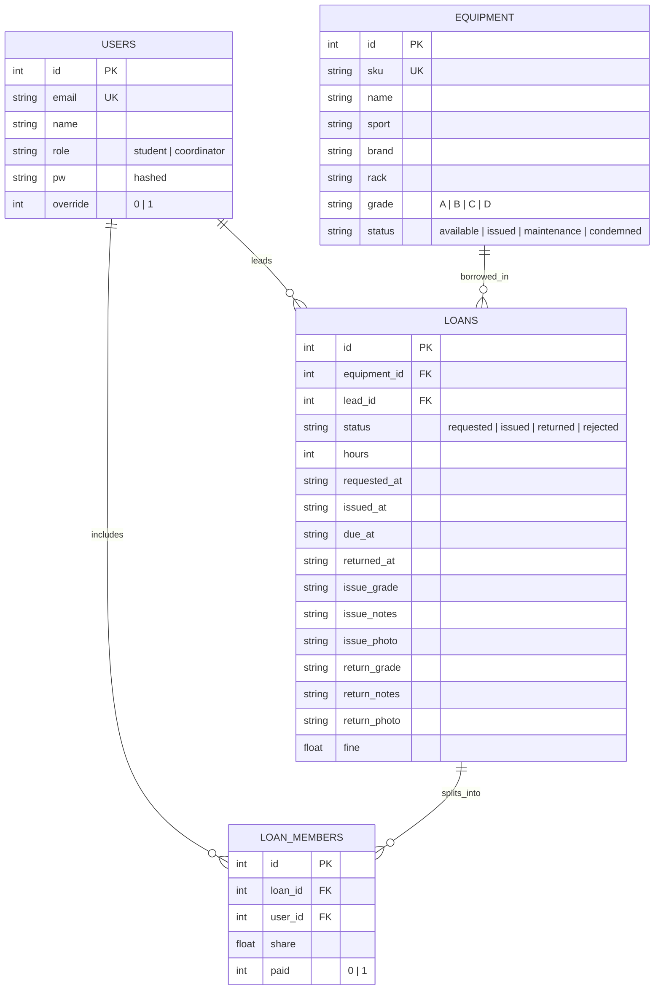
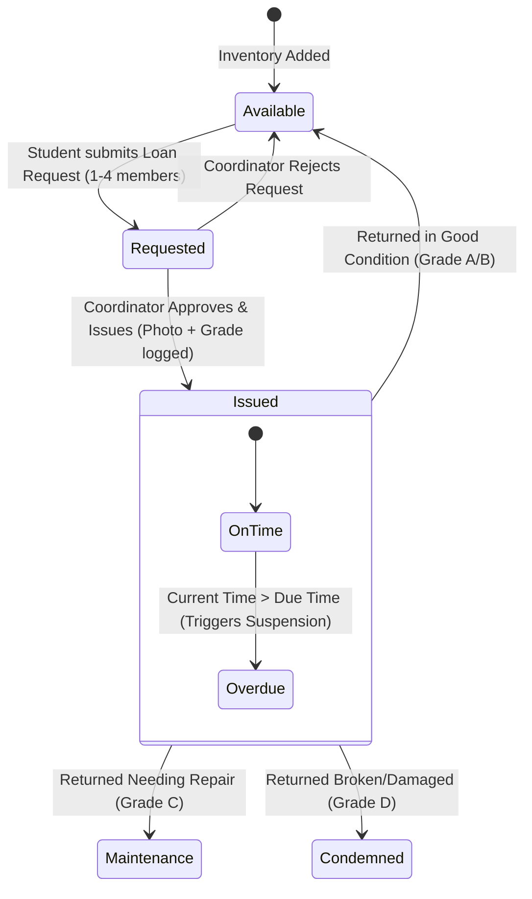

# Sitare Sports Desk & Equipment Management Portal
## System Architecture, Design Specification & User Guide

---

### Executive Summary
The **Sitare Sports Equipment Management Portal** is a full-stack web application designed to streamline, digitize, and automate sports inventory tracking and equipment borrowing operations across campus. 

The system enforces accountability through **group borrowing accountability**, **automated fine splitting**, **condition grading (A–D)**, **photo audit logging (issue/return inspection)**, and **real-time standing/suspension checks**.

---

## 1. System Overview & Technology Stack

### 1.1 Tech Stack Components
* **Backend Framework:** Python 3 with Flask
* **Database Engine:** SQLite3 (`sports.db`) with Foreign Key constraints enabled
* **Authentication & Security:** 
  * Password hashing using Werkzeug (`pbkdf2:sha256`)
  * Domain restriction (enforcing `@sitare.org` email domain)
  * Secret key authorization for Coordinator elevates
* **Frontend Architecture:**
  * HTML5 Jinja2 Templates (Modular with reusable UI macros)
  * Modern CSS3 Design (Custom dynamic themes, dark/light contrast cards, glassmorphism elements, CSS animations)
  * Vanilla JavaScript (`app.js`) supporting asynchronous search (`/api/equipment`), live stats counter updates, modal dialogs, and dynamic photo capture via WebCam / file uploads.

---

## 2. Core Features & Business Logic

### 2.1 Role-Based Portals

#### A. Student Portal (`/student`)
* **Real-Time Inventory Catalog:** Search and filter sports gear by name, sport category (Football, Cricket, Badminton, Volleyball, Athletics, Basketball, Table Tennis), SKU, or storage rack location.
* **Loan Requests:** Request equipment for flexible durations (1 to 72 hours).
* **Group Borrowing:** Borrowers can register up to 3 co-borrowers (group size of 1 to 4 members). All group members are linked to the loan record.
* **Standing Enforcement:** The portal automatically checks if the lead borrower or any co-borrower has overdue equipment or unpaid damage dues. If any member is suspended, the loan request is automatically blocked.
* **Personal Borrowing History:** View active loans, due timestamps, condition grades, and individual financial liability.

#### B. Coordinator / Sports Desk Portal (`/coord`)
* **Dashboard Analytics:** Live monitoring of total inventory metrics (Available, Issued, Maintenance, Condemned items).
* **Loan Request Processing:** Review pending student requests and approve (Issue) or reject them.
* **Issue Inspection:**
  * Assign initial condition grade (Grade A or B).
  * Add optional notes and capture/upload an issue photo proof.
  * System calculates exact due timestamp based on requested loan hours.
* **Return & Fine Management:**
  * Log return condition (Grade A–D).
  * Auto-update item status:
    * **Grade A / B:** Restores item to `available` on shelves.
    * **Grade C:** Sends item to `maintenance`.
    * **Grade D:** Flags item as `condemned` (decommissioned).
  * Assign damage or late fines (₹).
  * **Automated Equal Fine Distribution:** System calculates `share = fine / group_members_count` and assigns individual financial liability to each borrower in the group.
* **Dues & Suspension Oversight:**
  * View flagged students unable to borrow.
  * Register cash payments or execute instant administrative reinstatement.
* **Inventory & Asset Label Management:**
  * Add new inventory with auto-generated SKUs (e.g., `FOOT-0001`, `CRIC-0002`).
  * Generate printable barcode/QR asset tags (`/coord/label/<eid>`).
  * Track historical loan logs for every physical piece of equipment.

---

## 3. Database Schema Design

The application relies on four relational tables with strict foreign key constraints:



---

## 4. Key Workflows & State Diagrams

### 4.1 Equipment Loan Lifecycle



### 4.2 Fine Calculation & Standing Enforcement Workflow

```
1. Item Returned with Fine (F)
   └─ Group Size = N members
   └─ Calculated Share = F / N

2. Database Updates:
   └─ Insert Share into LOAN_MEMBERS for each student
   └─ Set paid = 0 (Unpaid)

3. Suspension Logic Check (standing(uid)):
   IF override == 1 -> GOOD STANDING (Exempted)
   ELSE IF active loan overdue -> SUSPENDED ("Overdue equipment")
   ELSE IF sum(unpaid shares) > 0 -> SUSPENDED ("Unpaid damage/late dues of ₹X")
   ELSE -> GOOD STANDING
```

---

## 5. Security & Validation Rules

1. **Email Domain Guard:** Only accounts ending with `@sitare.org` are permitted to authenticate or be registered as group members.
2. **Coordinator Gatekeeping:** Accessing or creating a coordinator account requires a valid **Coordinator Key** (`COORDINATOR_KEY`).
3. **Suspension Integrity:** Any loan request containing even one suspended co-borrower is rejected upfront.
4. **Audit Trail:** Every issue and return action supports image uploading (Base64 webcam snapshot or image file) saved securely under `/static/uploads/`.

---

## 6. API Reference

| Endpoint | Method | Role | Description |
| :--- | :--- | :--- | :--- |
| `/login` | GET/POST | Public | Authenticates users; auto-creates valid domain users. |
| `/logout` | GET | Authenticated | Clears session data. |
| `/` | GET | Authenticated | Renders Student Dashboard or Coordinator Desk based on user role. |
| `/api/equipment` | GET | Authenticated | Asynchronously fetches equipment inventory and status counters. |
| `/request` | POST | Student | Submits new equipment request with linked co-borrowers. |
| `/coord/issue/<lid>` | POST | Coordinator | Issues requested gear with grade, notes, and photo. |
| `/coord/reject/<lid>` | POST | Coordinator | Cancels a pending request. |
| `/coord/return/<lid>` | POST | Coordinator | Processes item return, updates condition grade, calculates split fines. |
| `/coord/pay/<mid>` | POST | Coordinator | Marks an individual member's fine share as paid. |
| `/coord/reinstate/<uid>`| POST | Coordinator | Clears all dues and sets override status for a suspended student. |
| `/coord/equipment` | POST | Coordinator | Creates or updates equipment inventory records. |
| `/coord/history/<eid>` | POST/GET | Coordinator | Returns JSON borrowing history for a specific asset. |
| `/coord/label/<eid>` | GET | Coordinator | Renders printable QR/barcode asset label tag. |

---

## 7. Summary & Conclusion
The Sitare Sports Equipment Management Portal replaces paper logs with an automated system. By integrating fine distribution, condition tracking, photo evidence, and automated suspension checks, the portal ensures university sports assets are maintained and accountable across campus.
